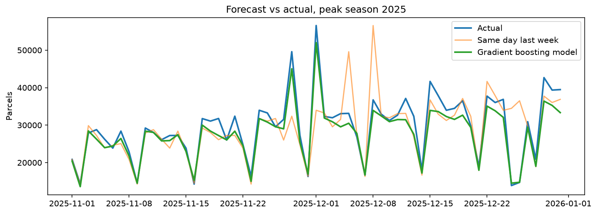
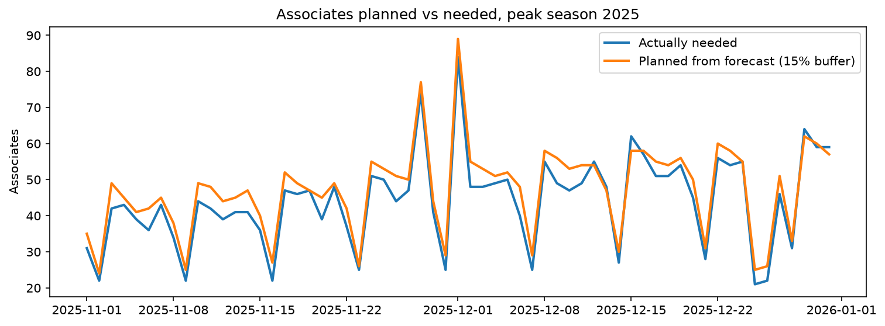
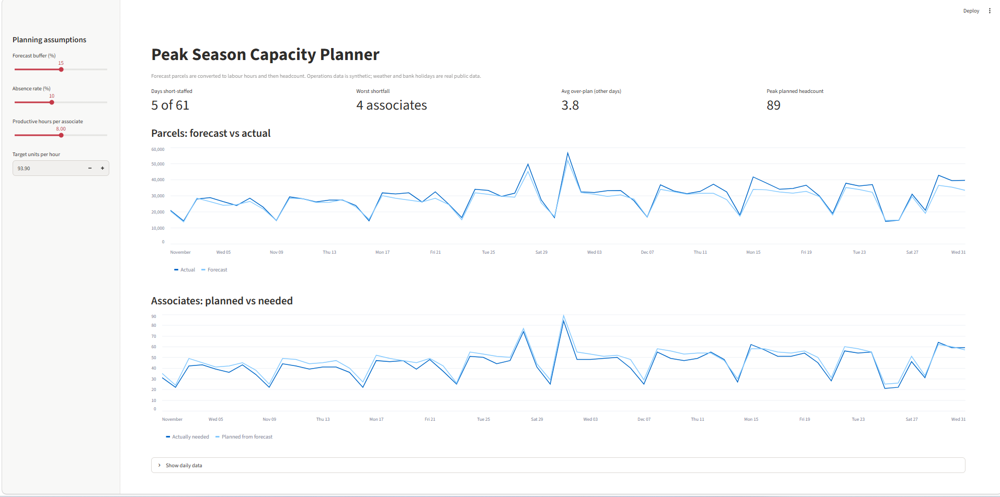

# Peak Season Delivery Demand & Capacity Forecaster

Forecasts daily parcel volumes for the UK peak season and converts the forecast into the headcount a delivery station would need to book. Built with Python, SQL (SQLite) and Streamlit.

> **Data note:** operations data (parcels, units per hour, labour hours, defects) is **synthetic**, generated in `src/generate_synthetic_ops.py`. Weather (Open-Meteo) and UK bank holidays (gov.uk) are real public data. No employer data is used.
> Because the synthetic data was built with known patterns, the model scores show that the pipeline works, not that real-world demand is this predictable.

## Pipeline

1. Ingest and clean weather, calendar and synthetic operations data (done)
2. Exploratory analysis (done)
3. Forecast models vs baselines (done)
4. Capacity calculator: parcels -> labour hours -> headcount (done)
5. Interactive dashboard (done)
6. Optional AWS layer: S3, Lambda, Athena (next)

## Results

### Forecast accuracy (peak season 2025, trained on data before 1 Nov 2025)

| Model | Average miss (parcels/day) | Average miss (%) |
|---|---|---|
| 7-day moving average | 6,278 | 25.8 |
| Same weekday last week | 3,824 | 13.9 |
| Gradient boosting (weather + calendar + lags) | 2,044 | 6.3 |



### Capacity planning

Forecast parcels are converted to labour hours (parcels / target units per hour), then to headcount allowing for 8 productive hours per person and 10% absence. A planning buffer adds extra volume to cover forecast error.

| Planning buffer | Days short-staffed (of 61) | Worst shortfall (associates) | Peak planned headcount |
|---|---|---|---|
| 0% | 43 | 11 | 77 |
| 15% | 5 | 4 | 89 |

Planning exactly to the forecast leaves the site short on most days. A 15% buffer almost removes shortfalls, at a cost of about 3.8 extra associates on an average day.



### Dashboard

An interactive Streamlit app for testing planning assumptions (buffer, absence rate, hours per associate, target units per hour).



## Limitations

- **Synthetic data.** The model rediscovers patterns built into the generator, so accuracy here is an upper bound.
- **Weather is not forecast.** The model uses the weather that actually happened. In real planning only a weather forecast would be available, so true accuracy would be lower.
- **Seven-day horizon.** Lag features need data from at least a week before the day being predicted.
- **Peak days are under-forecast.** The model tends to miss low on the highest-volume days, which is why the planning buffer matters. Tree-based models cannot predict beyond the volumes they trained on, so modelling the growth trend explicitly is the obvious next improvement.

## Run it

```bash
python -m venv .venv
source .venv/bin/activate        # Windows: .venv\Scripts\activate
pip install -r requirements.txt

python run_ingestion.py          # fetch weather and holidays, generate synthetic data
python run_forecast.py           # train the model, save the forecast
python -m streamlit run app.py   # open the dashboard
```

Data is stored in `data/processed/forecaster.db` (tables: `weather`, `calendar`, `ops_synthetic`, `forecast_peak_2025`, `forecast_metrics`).

## Project structure

```
run_ingestion.py     fetch and store data
run_forecast.py      train and save the forecast
app.py               Streamlit dashboard
src/
  config.py                 settings (location, dates, paths)
  ingest_weather.py         Open-Meteo weather
  ingest_holidays.py        gov.uk bank holidays and retail peak dates
  generate_synthetic_ops.py synthetic delivery-station data
  load_db.py                write tables to SQLite
  forecast.py               features, baselines, model
  capacity.py               parcels -> headcount
notebooks/           exploration and analysis (01 to 04)
images/              charts used in this README
```
